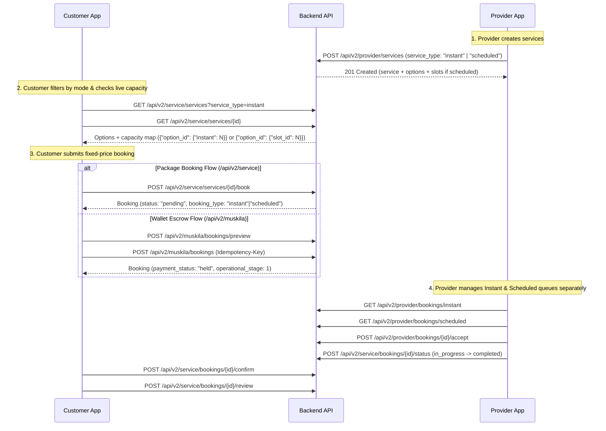

# Hal-Al Mushkila Mobile API & Integration Guide

Fixed-price, on-demand and scheduled service marketplace APIs for the **Customer App**, **Provider App / Workspace**, and **Dokan Wallet Escrow** workflows.

> **Important Behavioral Contract**
> - **Two Service Modes Only:** Every service package operates as either **`instant`** (immediate on-demand dispatch, no date/time slot required) or **`scheduled`** (customer selects a provider date & time slot).
> - **Separated Provider Bookings:** All bookings carry `booking_type` (`"instant"` | `"scheduled"`). Providers fetch and process Instant and Scheduled bookings separately.
> - **No Bargaining / No Quote Bidding:** All wage negotiation, counter-offers, direct custom offers, and quote-request bidding endpoints have been permanently removed. All bookings use fixed package/tier or provider fixed rates.

---

## 1. Base URLs, Headers & Conventions

| API Surface | Base Prefix | Route File | Auth Guard |
| :--- | :--- | :--- | :--- |
| **Muskila Flutter App API** | `/api/v2/muskila` | [routes/muskila_api.php](../../routes/muskila_api.php) | `auth:sanctum` (where marked 🔒) |
| **Service Customer API (v2)** | `/api/v2/service` | [routes/api.php](../../routes/api.php) | `auth:sanctum` (where marked 🔒) |
| **Provider Workspace API (v2)** | `/api/v2/provider` | [routes/api.php](../../routes/api.php) | `auth:sanctum` (all routes 🔒) |

### Required Request Headers

```http
Accept: application/json
Content-Type: application/json
App-Language: en
Authorization: Bearer <sanctum_personal_access_token>
```

- **Locale (`App-Language`):** Supports `en` and `ar` (handled by `app_language` middleware).
- **Timezone:** `Asia/Muscat` (UTC+4).
- **Currency:** `OMR` (Omani Rial). Wallet/escrow amounts in `/api/v2/muskila/*` round to 3 decimal places; `/api/v2/service/*` package options default to `OMR`.
- **Idempotency (Muskila Booking):** Pass `Idempotency-Key: <uuid>` header (or `idempotency_key` in body) on `POST /api/v2/muskila/bookings` to prevent double wallet debits on retries.

### Response & Error Formats

1. **Laravel Validation Errors (`422 Unprocessable Entity`):**
   ```json
   {
     "message": "The given data was invalid.",
     "errors": {
       "service_type": ["The selected service type is invalid."]
     }
   }
   ```
2. **Auth / Permission / State Errors:**
   - `401 Unauthorized` — Missing or invalid Sanctum token.
   - `403 Forbidden` — Accessing another user's booking/thread or non-matching resource.
   - `404 Not Found` — Missing entity or unapproved provider accessing `/api/v2/provider/*` (`firstOrFail`). Note: unmatched `GET /api/*` routes hit the global API fallback returning JSON `{ "data": [], "success": false, "status": 404, "message": "Invalid Route" }`.
   - `422` / `409` — Capacity exhausted or invalid status transition (e.g., accepting non-pending booking).

---

## 2. End-to-End Integration Flows



### Booking Lifecycle & Operational Stages

| Stage | Key | Trigger | DB `status` | Notes |
| :---: | :--- | :--- | :--- | :--- |
| `0` | `request_sent` | Package booking submitted (`/service/services/{id}/book`) | `pending` | Awaits provider `accept` or `decline` |
| `1` | `price_agreed` | Provider accepts pending request OR Muskila escrow checkout completes | `scheduled` | Scheduled & accepted instant jobs enter stage 1 (instant escrow checkout starts directly at `in_progress` when `when.type = "now"`) |
| `2` | `on_the_way` | Provider calls `POST /api/v2/muskila/pro/bookings/{id}/step` (`step: 2`) | `scheduled` / `in_progress` | Provider updates GPS via `location` endpoint |
| `3` | `in_progress` | Provider sets `status: "in_progress"` or advances `step: 3` | `in_progress` | Work in progress |
| `4` | `completed` | Provider sets `status: "completed"` or advances `step: 4` | `completed` | Ready for customer escrow release / confirmation |
| `5` | `confirmed` | Customer calls `confirm` or `release-escrow` | `completed` | Escrow `released`; customer can submit rating/review once |

> **Client UI Rule for Slots vs Instant:**
> - Read `service_type` on every service (`"instant"` or `"scheduled"`).
> - If `service_type === "scheduled"`, show the date/time slot picker using `slots` and send `provider_service_slot_id` when booking.
> - If `service_type === "instant"`, hide the slot picker, read remaining spots from `capacity[option_id].instant`, and omit `provider_service_slot_id`.

---

## 3. Muskila Customer & Pro App API (`/api/v2/muskila`)

Implemented in `App\Http\Controllers\Muskila\Api\*`. Paginated endpoints wrap items via `MuskilaHelper::paginatedResponse`:
```json
{
  "data": [ ... ],
  "links": { "first": "...", "last": "...", "prev": null, "next": null },
  "meta": { "current_page": 1, "last_page": 1, "per_page": 15, "total": 10 },
  "success": true,
  "status": 200
}
```

### 3.1 Metadata, Home & Search (Public / Optional Auth)

| Method | Endpoint | Auth | Query Params / Description |
| :--- | :--- | :--- | :--- |
| `GET` | `/api/v2/muskila/meta` | Public | Categories tree, Muscat areas, default lat/lng, schedule dates/slots, intake config, instant config, radius (`search_radius_km`). |
| `GET` | `/api/v2/muskila/home` | Optional 🔒 | Promotional slides; if authenticated, also returns `unread_notifications` and latest active booking (`active_job`). |
| `GET` | `/api/v2/muskila/search` | Public | `?q=<term>&category_id=<id\|slug\|all>` — returns matching `{ "data": { "services": [...], "pros": [...] } }`. |
| `GET` | `/api/v2/muskila/services` | Public | `?service_type=instant\|scheduled` (or `mode=instant\|schedule`), `?category_id=`, `?q=`, `?per_page=15`. |
| `GET` | `/api/v2/muskila/services/{id}` | Public | Single `ServiceResource` (`service_type`, `is_instant`, `from_price`, `inclusions`, etc.). |
| `GET` | `/api/v2/muskila/posts` | Public | Returns active provider services as `PostResource` (`is_bargainable: false`, `bargain_tiers: []`, `tiers: [...]`). Filters: `?service_type=`, `?category_id=`, `?per_page=`. |
| `GET` | `/api/v2/muskila/posts/{id}` | Public | Single service `PostResource`. |

### 3.2 Pros & Bookmarks

| Method | Endpoint | Auth | Params / Body |
| :--- | :--- | :--- | :--- |
| `GET` | `/api/v2/muskila/pros` | Public | `?category_id=`, `?date=` (omitting `date` filters to `is_online = true`), `?sort=nearest\|top_rated\|lowest_price`, `?lat=`, `?lng=`, `?per_page=15`. |
| `GET` | `/api/v2/muskila/pros/saved` | 🔒 | Customer's bookmarked pros. |
| `GET` | `/api/v2/muskila/pros/{id}` | Public | Detailed `ProDetailResource` including `skills`, `verifications`, `video`, and latest 3 approved `reviews`. |
| `GET` | `/api/v2/muskila/pros/{id}/reviews` | Public | Paginated approved `ReviewResource` list (`?per_page=15`). |
| `POST` | `/api/v2/muskila/pros/{id}/call` | 🔒 | Returns masked/direct phone `{ "data": { "phone": "+968..." } }`. |
| `POST` | `/api/v2/muskila/pros/{id}/save` | 🔒 | Bookmarks pro (`is_saved: true`). |
| `DELETE` | `/api/v2/muskila/pros/{id}/save` | 🔒 | Removes bookmark (`is_saved: false`). |

### 3.3 Inquiries & Instant Matching

#### `POST /api/v2/muskila/inquiries` 🔒
Creates/reuses a service chat thread with a provider and sends an intake summary message (pre-booking questions without price bargaining).
- **Body:** `pro_id` (required), `service_title`, `problem_nature`, `custom_problem`, `timing` (object), `tags` (array), `notes`.
- **Response:** `{ "result": true, "message": "Inquiry sent", "data": { "thread": ThreadResource, "inquiry_id": "<thread_id>" } }`.

#### `POST /api/v2/muskila/instant-requests` 🔒
Matches the nearest online verified provider (and their published `instant` service if available) at a **fixed price** (no `offered_price` bargaining).
- **Body:** `{ "category_id": "83", "notes": "Urgent tap leak", "lat": 23.5932, "lng": 58.4137 }`
- **Response:**
```json
{
  "result": true,
  "message": "Expert found",
  "data": {
    "instant_request_id": "12",
    "service_id": "45",
    "booking_type": "instant",
    "pro": { "...": "ProCardResource" },
    "service_title": "Instant Plumbing Service",
    "fixed_price": 15.0,
    "eta_minutes": 12,
    "when_text": "Now • arrives in 12 min",
    "expires_at": "2026-11-26T12:35:00+04:00"
  }
}
```

### 3.4 Wallet Escrow Bookings & Tracking (`Muskila\Api\BookingController`)

All checkout bookings compute prices server-side from the fixed `ProviderService` / `ProviderServiceOption` / `ProviderProfile` rate (`Platform Fee` added from `config('muskila.platform_fee')`, default `0.500 OMR`) and debit the customer's Dokan Wallet into `TransactionEscrow`.

| Method | Endpoint | Auth | Notes |
| :--- | :--- | :--- | :--- |
| `POST` | `/api/v2/muskila/bookings/preview` | 🔒 | Returns `service_title`, `pro_name`, `when_text`, `agreed_price`, `platform_fee`, `total`, `refund_note`. |
| `POST` | `/api/v2/muskila/bookings` | 🔒 | Debits wallet & creates booking + escrow. Supports `Idempotency-Key` header. |
| `GET` | `/api/v2/muskila/bookings` | 🔒 | Lists customer bookings. Filters: `?status=`, **`?booking_type=instant\|scheduled`**, `?per_page=15`. |
| `GET` | `/api/v2/muskila/bookings/{id}` | 🔒 | Single `BookingResource` (customer or assigned provider only). |
| `GET` | `/api/v2/muskila/bookings/{id}/tracking` | 🔒 | Returns `booking`, `pro_location` (`lat`, `lng`, `updated_at`), and 5-step `timeline`. |
| `POST` | `/api/v2/muskila/bookings/{id}/release-escrow` | 🔒 | Body: `rating` (required, 1–5), `review` (optional, max 1000). Credits provider wallet & saves review. |
| `POST` | `/api/v2/muskila/bookings/{id}/cancel` | 🔒 | Allowed when `operational_stage < 2`. Body: `reason` (optional). Refunds wallet escrow. |
| `POST` | `/api/v2/muskila/bookings/{id}/call` | 🔒 | Returns provider contact phone for active booking. |

**Checkout Body (`POST /api/v2/muskila/bookings/preview` & `POST /api/v2/muskila/bookings`):**
- `source`: required `"direct"` | `"service"` | `"post"` | `"instant"`
- Target identifiers based on `source`:
  - `direct`: `pro_id`
  - `service`: `service_id`, optional `tier_id`
  - `post`: `post_id`, optional `tier_id`
  - `instant`: optional `service_id` (uses fixed `instant` service tier/wage) + optional `tier_id`, or `pro_id` / `category_id`
- Timing: `"when": { "type": "now" | "schedule", "date": "YYYY-MM-DD", "slot_id": "09:00 - 11:00" }`
- Location: `address_id` OR (`location_text`, `lat`, `lng`)
- Optional: `notes`, `service_title`, `idempotency_key`

> Note: `POST /api/v2/muskila/bookings` requires sufficient `user.balance`; otherwise returns `422` (`wallet: ["Your wallet balance is too low. Please recharge."]`).

### 3.5 Chat, Notifications & Uploads

| Method | Endpoint | Auth | Params / Body |
| :--- | :--- | :--- | :--- |
| `GET` | `/api/v2/muskila/chat/threads` | 🔒 | Paginated service conversations (`ThreadResource`). |
| `POST` | `/api/v2/muskila/chat/threads` | 🔒 | Body: `pro_id` (required), `service_title`, `message` (max 2000). |
| `GET` | `/api/v2/muskila/chat/threads/{id}/messages` | 🔒 | Optional `?after_id=<msg_id>` for incremental polling. |
| `POST` | `/api/v2/muskila/chat/threads/{id}/messages` | 🔒 | Body: `{ "message": "..." }` (required, max 2000). |
| `POST` | `/api/v2/muskila/chat/threads/{id}/read` | 🔒 | Marks thread read for current participant. |
| `GET` | `/api/v2/muskila/notifications` | 🔒 | Paginated user notifications (`?per_page=15`). |
| `POST` | `/api/v2/muskila/notifications/read-all` | 🔒 | Marks all notifications as read. |
| `POST` | `/api/v2/muskila/uploads` | 🔒 | Supports Base64 (`image` string `<= 5MB`, optional `filename`) or multipart (`image` / `file`: `jpg,jpeg,png,webp`). Returns `{ "data": { "id": "...", "url": "..." } }`. |

### 3.6 Muskila Pro Workspace Execution (`/api/v2/muskila/pro`) 🔒

| Method | Endpoint | Params / Body & Notes |
| :--- | :--- | :--- |
| `POST` | `/api/v2/muskila/pro/status` | Update online toggle & GPS: `online` (boolean), `lat`, `lng`. |
| `GET` | `/api/v2/muskila/pro/bookings` | Assigned bookings. Filters: `?status=`, **`?booking_type=instant\|scheduled`**, `?per_page=15`. |
| `POST` | `/api/v2/muskila/pro/bookings/{id}/accept` | Accepts Step `0` booking -> advances to Step `1`. |
| `POST` | `/api/v2/muskila/pro/bookings/{id}/reject` | Declines booking and refunds customer wallet escrow. |
| `POST` | `/api/v2/muskila/pro/bookings/{id}/step` | Body: `{ "step": 1\|2\|3\|4 }` (`1: price_agreed`, `2: on_the_way`, `3: in_progress`, `4: completed`). |
| `POST` | `/api/v2/muskila/pro/bookings/{id}/location` | Body: `{ "lat": 23.59, "lng": 58.41 }` — updates live tracking coordinates. |
| `POST` | `/api/v2/muskila/pro/posts` | Quick-create service post. Body: `category_id`, **`service_type` (`scheduled\|instant`)**, `title`, `description`, `tiers[]` (`label`, `price`, `total_quota`). |
| `DELETE` | `/api/v2/muskila/pro/posts/{id}` | Deletes provider-owned `ProviderService` post. |

---

## 4. Hal-Al Mushkila v2 Customer & Provider API (`/api/v2/service` & `/api/v2/provider`)

Implemented in [HalAlMushkilaController.php](../../app/Http/Controllers/Api/V2/HalAlMushkilaController.php) and formatted with [BookingResource.php](../../app/Http/Resources/V2/BookingResource.php) and [ServiceProviderResource.php](../../app/Http/Resources/V2/ServiceProviderResource.php).

### 4.1 Customer Service Discovery & Package Booking (`/api/v2/service`)

| Method | Endpoint | Auth | Notes |
| :--- | :--- | :--- | :--- |
| `GET` | `/api/v2/service/categories` | Public | Nested category tree; pass `?flat=1` for flat list. |
| `GET` | `/api/v2/service/categories/{id}/subcategories` | Public | Child service categories for parent ID. |
| `GET` | `/api/v2/service/providers` | Public | `?q=`, `?category_id=`, `?rating=`, `?sort=recommended\|rating\|jobs`, `?per_page=12`. |
| `GET` | `/api/v2/service/providers/{id}` | Public | Verified active provider details, skills, availability & reviews. |
| `GET` | `/api/v2/service/services` | Public | Published packages. Filters: **`?service_type=instant\|scheduled`** (or `mode=instant\|schedule`), `?category_id=`, `?per_page=12`. |
| `GET` | `/api/v2/service/services/{id}` | Public | Service + options + slots + capacity (`capacity[option_id]['instant']` for instant; `capacity[option_id][slot_id]` for scheduled). |
| `POST` | `/api/v2/service/services/{service}/book` | 🔒 | Fixed-price booking request (`status: "pending"`). Slot required **only** if `service_type === "scheduled"`. |
| `GET` | `/api/v2/service/bookings` | 🔒 | Customer/Provider bookings (`?booking_type=instant\|scheduled`, 10/page). |
| `POST` | `/api/v2/service/bookings/{booking}/status` | 🔒 | Body: `status` (`in_progress\|completed\|cancelled`), `cancellation_reason`. Customer can only cancel; provider updates execution stages. |
| `POST` | `/api/v2/service/bookings/{booking}/cancel` | 🔒 | Shortcut to cancel with optional `cancellation_reason`. |
| `POST` | `/api/v2/service/bookings/{booking}/confirm` | 🔒 | Customer confirms completed job (`status === "completed"`), setting `operational_stage = 5` & releasing escrow. |
| `POST` | `/api/v2/service/bookings/{booking}/review` | 🔒 | Customer submits review after confirmation: `rating` (`1..5`), `comment` (optional). |

**`POST /api/v2/service/services/{service}/book` Payload:**
```json
{
  "provider_service_option_id": 10,
  "provider_service_slot_id": 22,
  "booking_quantity": 1,
  "service_address": "Villa 14, Way 2105, Al Khuwair, Muscat",
  "customer_note": "Gate code 1234"
}
```
- Omit `provider_service_slot_id` (or pass `null`) when booking an **`instant`** service.
- Returns HTTP `200` with `BookingResource` containing `booking_type` (`"instant"` or `"scheduled"`), `status: "pending"`, and `provider_service.service_type`.

### 4.2 Provider Onboarding & Workspace (`/api/v2/provider/*`) 🔒

Every endpoint under `/api/v2/provider/*` (except `application`) requires a `ProviderProfile` with `verification_status === 'verified'` and `is_active === true` (returns `404` while pending/rejected).

#### Onboarding & Profile
| Method | Endpoint | Notes |
| :--- | :--- | :--- |
| `GET` | `/api/v2/provider/application` | Returns current application status (`pending`, `verified`, `rejected`) or `data: null`. |
| `POST` / `PUT` | `/api/v2/provider/application` | Multipart form: `provider_type` (`individual\|company`), `phone`, `country`, `city`, `category_id`, optional `business_name`, `governorate`, `address`, `bio`, `experience_years`, `hourly_rate`, `trade_license_number`, `id_document_number`, files (`trade_license_file`, `id_document_file`, `certificate_file` max 10MB). Resets profile to `pending` until admin approval. |
| `GET` | `/api/v2/provider/dashboard` | Returns `provider` + separated live counters: `instant_pending_bookings`, `scheduled_pending_bookings`, `instant_active_bookings`, `scheduled_active_bookings`, `active_bookings`, `completed_bookings`. |
| `GET` | `/api/v2/provider/profile` | Approved provider profile details, skills, availability. |
| `PUT` | `/api/v2/provider/profile` | Update `business_name`, `phone`, `country`, `governorate`, `city`, `address`, `bio`, `experience_years`, and `avatar_file` / `photo`. |
| `GET` / `POST` / `DELETE` | `/api/v2/provider/skills` (`/skills/{skill}`) | Manage category skills (`category_id`, `experience_years`, `hourly_rate`, `certificate`, `certificate_file`). |
| `GET` / `POST` / `DELETE` | `/api/v2/provider/availability` (`/availability/{availability}`) | Manage weekly schedule (`day_of_week: 0..6`, `start_time: H:i`, `end_time: H:i`, `is_available`). |

#### Provider Services Management (`instant` vs `scheduled`)
| Method | Endpoint | Notes |
| :--- | :--- | :--- |
| `GET` | `/api/v2/provider/services` | Paginated list of provider's own services. Supports **`?service_type=instant\|scheduled`**. |
| `POST` | `/api/v2/provider/services` | Creates new service (`status: "pending"` awaiting admin approval). |
| `PUT` | `/api/v2/provider/services/{service}` | Updates service (blocked `422` if service already has bookings). |
| `POST` | `/api/v2/provider/services/{service}/toggle` | Toggles `is_active`. |
| `DELETE` | `/api/v2/provider/services/{service}` | Deletes service (blocked `422` if bookings exist). |

**Create / Update Service Validation (`POST` / `PUT /api/v2/provider/services`):**
```json
{
  "category_id": 83,
  "service_type": "scheduled",
  "title": "Split AC Chemical Wash",
  "description": "Deep indoor & outdoor unit wash",
  "wage": 15.0,
  "wage_type": "fixed",
  "options": [
    { "name": "1 Unit", "description": "Filter + coil", "price": 15, "capacity": 2 }
  ],
  "slots": [
    { "slot_date": "2026-12-01", "start_time": "09:00", "end_time": "11:00" }
  ]
}
```
- `service_type` is **required** (`"scheduled"` or `"instant"`).
- `options`: array of 1 to 3 fixed-price tiers (`name`, `price`, `capacity >= 1`).
- `slots`: **required (`min: 1`)** when `service_type === "scheduled"`, and **ignored / not required** when `service_type === "instant"`.
- `wage_type`: `fixed` | `hourly` | `per_visit`.

#### Provider Separated Bookings Queue
| Method | Endpoint | Notes |
| :--- | :--- | :--- |
| `GET` | `/api/v2/provider/bookings/instant` | **Instant Bookings only** (`booking_type = 'instant'`). Supports `?status=` & `?per_page=`. |
| `GET` | `/api/v2/provider/bookings/scheduled` | **Scheduled Bookings only** (`booking_type = 'scheduled'`). Supports `?status=` & `?per_page=`. |
| `GET` | `/api/v2/provider/bookings` | Combined queue with optional **`?booking_type=instant\|scheduled`** and `?status=` filters. |
| `POST` | `/api/v2/provider/bookings/{booking}/accept` | Accepts pending request -> `status: "scheduled"`, `operational_stage: 1`, creates escrow record. |
| `POST` | `/api/v2/provider/bookings/{booking}/decline` | Body: `{ "decline_reason": "..." }` (optional) -> `status: "declined"`. |

---

## 5. Removed Endpoints (Do Not Call From Mobile Clients)

The following legacy bargaining, custom request, and quote-bidding routes have been **removed** from [routes/api.php](../../routes/api.php) and [routes/muskila_api.php](../../routes/muskila_api.php):

- `/api/v2/muskila/pros/{id}/bargain-options` (`GET`)
- `/api/v2/muskila/posts` (`POST` request creation) & `/api/v2/muskila/posts/{id}/claim-tier` (`POST`)
- `/api/v2/muskila/quote-requests` & `/api/v2/muskila/quote-requests/{id}` (`GET`)
- `/api/v2/muskila/offers/{id}/accept` & `/api/v2/muskila/offers/{id}/counter` (`POST`)
- `/api/v2/muskila/pro/quote-requests`, `/api/v2/muskila/pro/quote-requests/{id}/quotes`, `/api/v2/muskila/pro/threads/{id}/offers`
- `/api/v2/service/requests*`, `/api/v2/service/offers/{bargain}/counter`, `/api/v2/service/offers/{bargain}/accept`, `POST /api/v2/service/bookings` (bargain-based)
- `/api/v2/provider/requests`, `/api/v2/provider/offers`, `POST /api/v2/provider/requests/{serviceRequest}/offers`

> **Mobile Migration Checklist:**
> 1. Remove bargain-tier selection, counter-offer sheets, `offered_price` sliders on `instant-requests`, and open quote-request forms in the Flutter client.
> 2. Render **Instant** vs **Scheduled** service tabs/badges using `service_type` and hide date/slot selectors when `service_type === "instant"`.
> 3. Split the Provider Bookings screen into **Instant Bookings** (`/bookings/instant` or `?booking_type=instant`) and **Scheduled Bookings** (`/bookings/scheduled` or `?booking_type=scheduled`).
